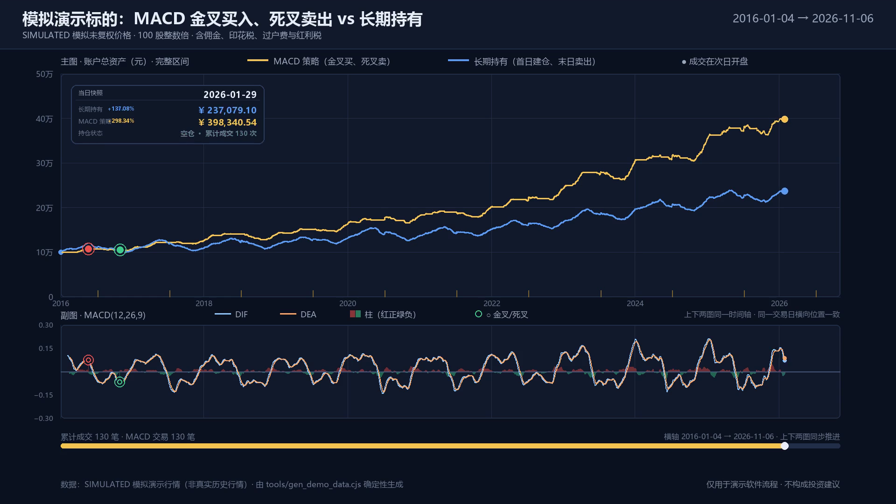

# StrategyToVideo

**把交易策略回测，变成动态视频。**  
*Turn Trading Strategy Backtests into Animated Videos.*

StrategyToVideo 是一个**开源、本地运行**的策略数据视频生成项目：从数据和回测结果出发，自动绘制资金曲线、交易信号与指标面板，并输出 MP4。你可以把它下载到自己的 Windows 电脑，通过**本地网页**操作；计算、渲染和视频保存都在本机完成。

> **English TL;DR:** StrategyToVideo runs entirely on your own Windows machine — it turns a strategy backtest into an animated MP4 through a local web page, with no cloud service and **no external AI API** required at runtime. **V0.1** (released) is a runnable reference implementation built on **SIMULATED data** with one fixed MACD demo. **V0.2.0** (released) adds user-provided CSV import for three data shapes — time series, cross-section, and stock daily OHLC (USER_IMPORT labeled) — with no source-code edits required. Stock OHLC import runs the full chain (validate → convert → MACD backtest → V1.2.3 render → independent acceptance) and a 260-trading-day sample passes 41/41 checks and delivers an MP4. **Supported stock data: unadjusted prices only** (qfq/hfq are actively rejected until execution-price accuracy is separately verified), **main-board A-shares only** (600/601/603/605 and 000/001/002/003), with **dividends supplied in a separate CSV** — without that file the result excludes cash dividends and ex-right gaps are treated as ordinary price drops. Figures produced from your own files are your own data: the tool checks format and internal consistency, **not** whether the data is real, complete, or matches your broker; backtest amounts are a local simulation, not real account fills, and not investment advice. Windows is the only verified platform.

**为什么选择本地运行？** 尽可能减少对云服务和付费 API 的依赖，降低重复制作视频的成本，并让数据、流程和生成结果更容易复现。**运行时不需要 AI 模型、外部 AI API 或在线行情 API**；首次安装依赖通常需要联网。本地网页使用的 HTTP API 只在本机提供服务，并非云端网站。

> **当前版本状态：** **V0.1 已发布** —— 使用**模拟数据**运行一套固定 MACD 策略，对比“MACD 金叉买入、死叉卖出”和“买入后长期持有”，并生成演示视频。**V0.2 已发布（v0.2.0，从源码运行即可用）** —— 新增**用户 CSV 导入**通道（时间序列 / 分类对比 / 股票日线三类），可在网页内选文件、映射字段并生成视频，**无需修改源码**；股票日线通道走「校验 → MACD 回测 → V1.2.3 渲染 → 独立验收」全链路并交付 MP4（260 日样例 41/41 通过；V0.1 演示继续使用 V1.2.2 封版路径，40/40 通过，画面与时间轴口径已冻结）。复权口径只支持未复权 + 分红表。网页端自定义策略、自然语言生成策略仍不支持；开发中的 CLI 已支持两张策略卡（见下）。

## 看看它能生成什么



*图为 V0.1 实际生成的视频画面，使用 SIMULATED 模拟数据，不是真实证券行情或投资收益。视频采用 1920×1080、30fps，约 52.8 秒；MP4 不随源码包附带，可在本地自行生成。*

## 现在能做什么

**V0.1 已发布（固定 MACD 演示）**

- **本地安装、本地网页操作：** 下载 ZIP 或克隆代码，在 Windows 上启动 `http://127.0.0.1:8080/`，无需部署在线服务。
- **回测与对比：** 使用随包提供的可复现模拟数据，运行固定的 MACD(12,26,9) 策略，并与长期持有进行对比。
- **自动生成视频：** 展示资产曲线、金叉/死叉与买卖事件、MACD 指标、当日快照和期末结果。
- **预览与导出：** 在本地网页查看任务进度，预览、下载 MP4；服务重启后可查询已有任务。
- **结果校验：** 自动执行数据与视频的一致性验收，检查金额、信号、日期和画面等关键内容。

**V0.2 已发布（v0.2.0，从源码运行即可用）**

- **导入自己的 CSV：** 在网页内选择本地 CSV 文件，先看前几行预览，确认后再提交。
- **字段映射，不改源码：** 目标字段（如 `date` / `value` / `label`）与 CSV 列名的对应关系在界面里点选；列名不必和示例文字一致，中英文表头都能用。
- **三类用户数据：** 时间序列（折线动画，可含多条序列对比）、分类对比（条形动画，含负值、可选分组与第二数值列、占比标注），以及股票日线 OHLC（校验 → MACD 回测 → V1.2.3 渲染 → 独立验收，未通过不交付）。
- **契约先行、错误可读：** 完整输入契约见 [`docs/DATA_SPEC.md`](docs/DATA_SPEC.md)，样例与预期结果见 [`docs/samples/`](docs/samples/)。格式不合法时会返回**明确错误码与行号**（如千分位未加引号、行字段数不一致、日期乱序、重复标签），而不是静默出错。
- **数据来源标注：** 导入类视频画面会标注文件名、导入时间与“用户导入”徽标，不会把用户文件伪装成官方行情。

**开发中（已接入本机网页）：策略卡直出片**

- 网页里选「策略回测视频（自动取数）」，填**证券代码 + 区间 + 策略模板**，点击执行即可：
  后端自动取真实未复权日线 → 统一门禁 → 统一回测 → 策略视频，**不需要你准备 CSV**。
- 当前支持两张策略模板：`macd_cross`（金叉买入 / 死叉卖出，并与长期持有对照）与
  `close_buy_open_sell`（尾盘买入 / 次日开盘卖出，可带开盘跳空过滤）。
- 视频只读统一 `backtest_result.json`：价格曲线、买卖标记、持仓区间、策略资产、当前/期末指标与来源/免责声明。
- 任务仍是「创建 → 人工确认执行」两步；执行完可预览/下载 MP4，并可下载本次实际使用的日线 CSV
  与逐行溯源清单。
- 边界：仅沪深主板；复权口径固定未复权；不提供分红表时结果不含现金分红；取数依赖东方财富公开接口
  （网络不可用时任务直接失败，不会产出空片）；仍是**本机 127.0.0.1**，未做公开部署。

这是一套**流程演示与视频生成工具**，不是已支持任意策略的量化交易平台。V0.1 的标的、时间区间、本金和策略参数均为固定配置；V0.2 支持**通用图表类**与**股票日线（USER_IMPORT）**数据的导入出片，股票通道由 V1.2.3 独立验收把关；开发中的**策略卡通道**已接入本机网页，支持两张模板自动取数出片（未通过首版验收则不交付）。

**你需要准备什么样的数据**

| 想要的视频 | 必须的列 | 可选的列 | 生成结果 |
| --- | --- | --- | --- |
| 时间序列折线 | `date` + 至少一条数值列（最多 6 条序列） | 序列名列 | 折线生长动画 |
| 分类对比条形 | `label` + `value` | `group`（分组）、`value2`（对照值） | 条形动画 |
| 股票日线（MACD 回测） | `date`、`open`、`high`、`low`、`close` | `volume`、`amount` | 回测 + V1.2.3 视频 |
| 现金分红（可选，独立 CSV） | `ex_date`、`record_date`、`pay_date`、`cash_per_share` | `share_ratio`、`plan` | 计入股票回测 |

列名不必与上表完全一致，界面上可以点选「字段 → 列名」的映射，中英文表头都能识别。文件要求：**UTF-8 编码、逗号分隔、单文件 ≤ 2 MiB**（约 4 万行以内；股票日线通常远小于此）；用 Excel 导出时请选「另存为 → CSV UTF-8（逗号分隔）」，GBK 等编码会直接被提示无法解码，不会静默出错。

股票数据的额外条件（代码范围、复权口径、最短数据长度、分红表规则）以及生成结果的解读方式，见下文 **「股票日线：需要什么、结果意味着什么」**。

## 下载与本地运行

**系统要求：** Windows、Node.js ≥18、Python ≥3.11。目前**只在 Windows 上验证过**：Linux/macOS 的字体、路径与编码环境尚未适配验证，不承诺可用。网页不需要额外安装 npm 第三方依赖；Python 依赖见 [`requirements.txt`](requirements.txt)。目前提供的是**源码安装**，不是双击即用的 `.exe` 安装包。

1. 在 GitHub 点击 **Code → Download ZIP**，解压；或使用 `git clone` 下载仓库。
2. 在终端进入解压后的**项目根目录**（包含 `README.md`、`package.json` 和 `requirements.txt`）。
3. 执行：

```powershell
python -m pip install --target deps -r requirements.txt
npm start
```

4. 在浏览器打开 **http://127.0.0.1:8080/**。
5. 选择 **MACD 演示策略（模拟数据）** → **创建任务** → **确认并生成视频**。完成后即可在本地网页预览或下载 MP4。
6. （V0.2）也可选择 **导入 CSV · 时间序列**、**导入 CSV · 分类对比** 或 **导入 CSV · 股票日线**，选一个本地 CSV，确认字段映射后创建任务。股票日线还需填写 6 位证券代码（**仅沪深主板**，如 600000）、复权口径（**仅未复权**）与可选分红 CSV。想先试通流程，可直接用 [`docs/samples/`](docs/samples/) 里的样例文件。
7. （V0.2）出片后，工作区会显示**数据溯源**：时间序列/分类对比的每个数据点、股票日线的每根 K 线与每条分红记录，都对应留档 CSV 的第几行、原样内容是什么，并可下载留档的原始 CSV。股票视频里的金额与信号是回测按这些输入推导的，不是 CSV 里的原始数字——溯源清单核对的是输入本身。删除任务会连同原始 CSV 与视频一起清理。

数据留档与可复现性：创建任务时，原始 CSV 会原样存到 `web/tasks/<任务ID>/source.csv`（只在本机，已被 `.gitignore` 排除），并计算 SHA-256；视频页脚显示该指纹前 12 位。**在同一台机器、同一套依赖下**，同一份 CSV 重复出片应得到**逐字节相同**的 MP4，可用 `npm run check:determinism` 自行对拍；换机器或换系统字体版本可能出现像素级差异（画面内容、金额与验收结论不变）。样例规则与股票溯源的断言入口是 `npm run check:samples`，`/api/health` 能力口径的断言入口是 `npm run check:api`。

安装时会从 PyPI 获取 Pillow 和 imageio-ffmpeg；**依赖安装完成后，回测、渲染和视频生成均可离线进行**。渲染器会通过 `imageio_ffmpeg.get_ffmpeg_exe()` 查找编码器，无需手工配置 FFmpeg 的 PATH。建议按上述命令将依赖装入项目内的 `deps/`，否则 `/api/health` 的 `renderEnv.ready` 状态可能显示 `false`。

需要离线安装依赖时，请先自行从 PyPI 下载与 `requirements.txt` 版本一致、且匹配本机 Windows 与 Python 版本的 wheel 文件（Pillow 13.0.0、imageio-ffmpeg 0.8.1），放到项目根目录下自行建立的本地目录（例如 `wheels/`），然后执行：

```powershell
python -m pip install --target deps --no-index --find-links wheels -r requirements.txt
```

`wheels` 请换成你实际存放 wheel 文件的目录名。

模拟数据已经随包提供。若想按固定种子重新生成：

```powershell
node tools/gen_demo_data.cjs
```

## 接下来准备做什么

| 阶段 | 方向 | 状态 |
| --- | --- | --- |
| **V0.1** | 本地网页 + 固定 MACD 回测 + 模拟数据自动出片 | 已发布 |
| **V0.2** | 允许导入自己的 CSV 数据，沿用现有模板生成视频 | **已发布 v0.2.0**（时间序列 / 分类对比 / 股票日线均可出片；股票日线走 V1.2.3 渲染/验收，复权口径仅支持未复权 + 分红表，见下） |
| **V0.3（开发中）** | 策略卡 → 自动取数 → 统一回测 → 通用策略视频 | **本机网页已接入**：填代码+区间+模板即可出片（两张模板；真实 600000 网页路径 20/20 验收、815/815 溯源）；公开部署未做 |
| **后续** | 增加可组合策略模板；将自然语言作为“生成策略卡”的翻译层；网页任务队列与公开部署 | 探索中 |

**长期方向：** 逐步把“输入策略 → 自动取数 → 回测 → 视频”做成易用、可复现的工作流；**网页端的自定义策略仍属于未来功能**，当前仅两张内置模板可用。AI 可以在未来帮助理解策略或组织流程，但不应成为每次生成视频都必须调用的收费环节。上述路线图不是已上线功能，也不承诺发布时间。

## 数据说明与当前限制

**SIMULATED 模拟数据声明：** V0.1 的行情、交易日历和现金分红由 [`tools/gen_demo_data.cjs`](tools/gen_demo_data.cjs) 使用固定种子生成，存放在 `output/demo_macd_simulated/01_data/`。它们**不是任何真实证券的历史数据**；视频中的收益、日期、金额及交易信号均不代表真实投资结果，不能用于投资分析或策略评价，也不构成投资建议。

**用户导入数据的声明：** V0.2 导入通道只做**格式校验与内部一致性校验**，不核对数据真实性、完整性与复权口径。视频画面标注“用户导入”及文件名，**收益与结论由你提供的数据决定，项目不对其准确性负责**，同样不构成投资建议。

### 股票日线：需要什么、结果意味着什么

**准备数据**

- **代码范围：** 仅**沪深主板** 6 位代码（600/601/603/605、000/001/002/003）。创业板（300/301）、科创板（688/689）、北交所（4/8/92 开头）、B 股（200/900）按代码直接拒绝；**ST / 退市整理**按你填写的证券名称判断并拒绝，名称留空时只校验代码段。
- **价格口径：只接受未复权价格（`adjust=none`）。** 前复权 qfq / 后复权 hfq 会被**主动拒绝**（`E_ADJUST_UNVERIFIED`），因为复权价是合成价，回测拿它当真实成交价会算错金额与费用（实测同一数据换用真实 qfq 因子后 5/23 笔交易日期改变、终值差约 2,554 元）。要做含分红的回测，请用**未复权行情 + 分红表**。
- **数据长度：** 至少 **34 个交易日**（MACD 预热需要 33 天），且起点**不早于 2015-08-01**（更早时段缺少过户费等费率规则）。
- **现金分红：放在独立的 CSV 文件里**，不是行情文件的附加列。必须含 `ex_date`（除权除息日）、`record_date`（股权登记日）、`pay_date`（派息日）、`cash_per_share`（每股现金红利）四列，可选 `share_ratio`、`plan`；三个日期都必须落在行情 CSV 的交易日历内，缺任一日期即拒绝（不接受“按除息日默认到账”）。配股 / 缩股 / 换股 / 分拆不支持。
- **停牌：** CSV 只有交易日行，无法表达停牌；日期缺口只提示、不拒绝。

**没有提供分红表时会发生什么**

- 任务**仍可正常出片**，但结果**不含现金分红**：除权当天的跳空被当作普通价格下跌处理，收益会少计分红；参数里会给出 `W_NO_DIVIDENDS` 提示，视频副标题写「未提供分红表」，片尾也不会写「已扣除红利税」。
- 若希望结果接近真实账户，请补充分红表。

**结果意味着什么**

- 校验只覆盖**格式与内部一致性**——列是否齐全、日期是否有序不重复、OHLC 是否合法、金额是否等于价格×股数、是否 100 股整手与 T+1 成交、留档 CSV 与画面数字是否勾稽。**它不核实**你的数据是否真实、是否完整、是否与你券商导出的完全一致。
- 回测金额是**本地模拟撮合**：未复权价 + 佣金 / 印花税 / 过户费 + 红利税分档，不含滑点、排队、实际佣金差异和分红到账时间差异，**不等于真实账户的成交结果**。
- 视频、金额与结论**不构成投资建议**。

目前**不支持**以下内容：

- **复权行情（qfq / hfq）**（原因见上）、**网页端自定义新策略、自然语言生成策略。** 网页端策略模板仍为固定实现，策略卡通道只开放 `macd_cross` 与 `close_buy_open_sell` 两张模板，参数范围也受锁定（如 MACD 固定 12/26/9）。股票口径的拒绝码为 `E_ADJUST_UNVERIFIED`，契约见 [`docs/DATA_SPEC.md`](docs/DATA_SPEC.md) §7.2。
- **非 Windows 平台的正式支持。** Linux/macOS 的字体和编码环境尚未完成适配验证。


## 项目如何工作

```text
本地浏览器（127.0.0.1:8080）
  → 选择策略 / 选择 CSV、确认字段映射
  → 创建任务、人工确认执行
  → 本地任务管理与策略适配器
  → 数据校验与归一化（导入通道）／MACD 回测（演示通道）
  → 视频逐帧渲染与编码（Python / FFmpeg）
  → 独立一致性验收（报告与画面勾稽）
  → 本地预览与 MP4 下载
```

这里的任务编排是确定性代码，**不是运行中的 AI Agent**。本地 HTTP 接口（如 `/api/tasks`）可供二次开发使用，但项目不调用外部 AI 或行情服务。

- **数据示例：** `output/demo_macd_simulated/01_data/`
- **导入契约与样例：** `docs/DATA_SPEC.md`、`docs/samples/`
- **CSV 解析与校验：** `web/src/csv.js`、`web/src/import/`
- **通用图表渲染：** `engine_next/render_generic_chart.py`（适配器：`web/src/adapters/genericChart.cjs`）
- **回测、渲染与验收：** `engine_next/`
- **本地网页：** `web/`
- **模拟数据生成器：** `tools/gen_demo_data.cjs`
- **任务产物：** `output/web_<taskId>/`；任务状态与视频副本：`web/tasks/<taskId>/`

可自行运行的检查：

```powershell
npm run check:samples
npm run check:api
```

`check:samples` 按 `docs/DATA_SPEC.md` 的真实规则跑一遍 `docs/samples/` 下的全部样例，含应通过、应拒绝、千分位规则、换表头变体与股票通道的 K 线/分红溯源（篡改一行即拒绝）。`check:api` 断言 `/api/health` 的 `executableStrategies` 与实际可执行策略一致（包含 `stock_ohlc`）。网页生成视频时会自动调用独立验收脚本；也可以对已完成任务手动复核：

```powershell
python engine_next/tests/accept_macd_video_v122.py --run web_<taskId> --source web_<taskId>
```

股票 CSV（V0.2 / V1.2.3）用另一份独立验收脚本，41 项：

```powershell
python engine_next/tests/accept_macd_video_v123.py --run web_<taskId> --source web_<taskId>
```

MACD 通道的校验包括回测金额与视频结果、交易信号与成交、T+1 执行日期、时间轴、抽样帧对账及画面布局等；导入通道的校验是渲染报告与归一化模型的勾稽（类别、行数、序列/条形数量、输出字节数），不一致即拒绝交付。项目目前未随包提供 `node --test` 测试套件；上述脚本是当前的验收入口。


## 开源许可与第三方组件

项目主体代码采用 **MIT License**，见 [`LICENSE`](LICENSE)。第三方依赖与许可说明见 [`THIRD_PARTY_NOTICES.md`](THIRD_PARTY_NOTICES.md)：Pillow 13.0.0（MIT-CMU）、imageio-ffmpeg 0.8.1（BSD-2-Clause），以及由其 wheel 提供的 **GPLv3 构建的 FFmpeg**。

仓库不随附 FFmpeg 二进制、wheel 或字体。用户通过 pip 安装第三方程序**不会改变其自身许可证**；如将相关二进制重新打包分发，应自行核查和遵守对应许可义务。上述说明不构成法律意见。
